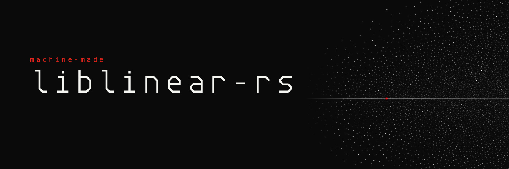

[](https://github.com/machine-made/liblinear-rs/actions/workflows/ci.yml)
[](Cargo.toml)
[](LICENSE)

`liblinear-rs` is a pure Rust port of [LIBLINEAR](https://www.csie.ntu.edu.tw/~cjlin/liblinear/)
2.50, the library for linear classification, regression and one-class
detection on large sparse data. There is no C code, no unsafe code and no
optional feature.

The port follows the original algorithm and its floating-point operation
order. On 158 saved test cases, every output field matches the original C
program bit for bit. On 20 pairs of four real datasets and a solver, up to 32561
rows and 47236 features, the weights and predictions also match bit for bit on
Linux with glibc 2.39; see `docs/PARITY.md`.

> **Status.** Version 0.0.1. All 12 solvers train and predict. The crate is
> not on crates.io yet, and its API can still change. The checks below cover
> the saved cases only; they do not prove a match on every input.

## What it solves

| Solver | Name in LIBLINEAR | Task |
| --- | --- | --- |
| 0 | `L2R_LR` | Logistic regression, L2 penalty, primal |
| 7 | `L2R_LR_DUAL` | Logistic regression, L2 penalty, dual |
| 6 | `L1R_LR` | Logistic regression, L1 penalty |
| 2 | `L2R_L2LOSS_SVC` | Support vector classification, L2 loss, primal |
| 1 | `L2R_L2LOSS_SVC_DUAL` | Support vector classification, L2 loss, dual |
| 3 | `L2R_L1LOSS_SVC_DUAL` | Support vector classification, L1 loss, dual |
| 5 | `L1R_L2LOSS_SVC` | Support vector classification, L1 penalty |
| 4 | `MCSVM_CS` | Multiclass support vector classification (Crammer and Singer) |
| 11 | `L2R_L2LOSS_SVR` | Support vector regression, L2 loss, primal |
| 12 | `L2R_L2LOSS_SVR_DUAL` | Support vector regression, L2 loss, dual |
| 13 | `L2R_L1LOSS_SVR_DUAL` | Support vector regression, L1 loss, dual |
| 21 | `ONECLASS_SVM` | One-class support vector machine |

Solvers 0 to 7 handle two or more classes. The solver numbers are those of
LIBLINEAR, so a parameter file for the C library keeps its meaning.

## Use it

Until the crate is published, depend on it from Git:

```toml
[dependencies]
liblinear = { git = "https://github.com/machine-made/liblinear-rs" }
```

Train on rows in memory, then predict:

```rust
use liblinear::{Feature, Parameter, Problem, SolverType, train};

let parameter = Parameter {
    solver_type: SolverType::L2rL2lossSvc,
    eps: 0.1,
    c: 1.0,
    class_weights: Vec::new(),
    p: 0.1,
    nu: 0.5,
    init_sol: None,
    regularize_bias: true,
    w_recalc: false,
};
let problem = Problem {
    solvers: vec![SolverType::L2rL2lossSvc],
    parameter: parameter.clone(),
    nr_feature: 1,
    bias: -1.0,
    labels: vec![1.0],
    rows: vec![vec![Feature { index: 1, value: 1.0 }]],
};
let model = train(&problem, &parameter)?;
let predictions = model.predict(&problem)?;
assert_eq!(predictions.len(), 1);
# Ok::<(), liblinear::Error>(())
```

`read_problem` loads a case file in the format of the reference cases
(see [reference/README.md](reference/README.md)).

Things to know:

- Feature indices start at 1 and increase within each row.
- Set `bias` to a nonnegative number to add a bias feature to each row.
- `train` borrows its inputs and returns an owned `Model`. It does not print.
  Each call starts the random stream at seed 1, as the C library does.
- `Model` holds the weights, `rho` for one-class models, the labels, and the
  decision values and predictions for the training rows. `Model::predict` and
  `Model::decision_values` score another `Problem`.
- `Error` names the failed check and the correction.
- Results are the same on every run and every thread count on one CPU type.
  The crate uses no threads.

[CONTRACT.md](CONTRACT.md) lists the units, shapes, error rules and the
source map for every solver.

## How the match is checked

1. **Frozen reference.** `vendor/liblinear/` holds the unchanged LIBLINEAR 2.50
   source and its BLAS files. `reference/` holds 158 input cases, covering all
   12 solvers, and the results of the C program for each case, built with
   g++ 13.3.0 at `-O0` and `-O2`. The two builds agree exactly.
2. **Exact comparison.** The tests require equal floating-point bits for every
   output field: weights, decision values, predictions, labels and `rho`.
   [reference/tolerances.json](reference/tolerances.json) states the rule for
   each field.
3. **Edge cases.** Cases cover `C` from 1e-6 to 1e6, `eps` from 1e-1 to 1e-8,
   class weights, bias on, off and free, zero columns, copied rows, one-row
   problems, and the iteration-limit exits.
4. **Mutation checks.** A changed log, sum order, random generator, sort,
   shrinking rule or threshold must fail the comparison. Each has an ignored
   test that shows the failure.

Per-solver counts and the commands to reproduce them are in
[docs/PARITY.md](docs/PARITY.md).

### What is not proven

- Bit equality holds on the saved cases. It does not prove other inputs.
- The `exp` and `log` tables match glibc 2.39. Another C library needs the same
  table test before claiming the same result.
- Nonfinite inputs have no solver result. A `nu` of 1 has no finite one-class
  result.
- The crate makes no speed claim.

## Build and test

Use the stable Rust toolchain. Edition 2024.

```sh
cargo fmt --all -- --check
cargo clippy --locked --all-targets --all-features -- -D warnings
cargo nextest run --locked --all-features
cargo test --locked --doc --all-features
cargo deny check
```

To check the saved reference against its source, use Python 3.12, Bash and
g++ 13.3.0. No Python package and no network are needed:

```sh
python3 scripts/check_reference.py
python3 scripts/check_reference.py --self-test
```

`bash scripts/freeze_reference.sh` replaces the saved reference files. See
[reference/BUILD.md](reference/BUILD.md) for the build record and
[vendor/liblinear/PROVENANCE.md](vendor/liblinear/PROVENANCE.md) for the
source record. Fuzzing, proofs, Miri and mutation runs are started by hand
(workflow `heavy.yml`); see "Hand-run checks" in [CONTRACT.md](CONTRACT.md).

## Contributing and security

Send changes as pull requests; [CONTRIBUTING.md](CONTRIBUTING.md) lists the
gates. Report a vulnerability privately, as described in
[SECURITY.md](SECURITY.md).

## Licence

BSD-3-Clause, the licence of the original LIBLINEAR. See [LICENSE](LICENSE)
and [NOTICE](NOTICE). The upstream terms are copied unchanged in
[THIRD-PARTY-NOTICES](THIRD-PARTY-NOTICES).
